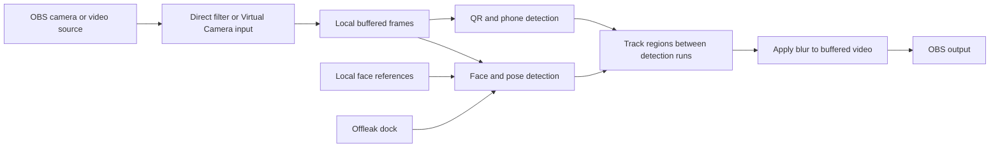

# Offleak

**Live on. Leak off.**

Offleak is an experimental, locally run privacy tool for video creators. It explores how to detect and blur bystanders, QR codes, and phone numbers in video while keeping selected people visible. The project includes a direct OBS filter prototype, a local OBS setup dock, a Virtual Camera integration, and a playground for reviewing experiments.

> **Experimental software, not a privacy guarantee.** Faces can be missed or matched to the wrong person; QR codes and phone numbers can remain visible. Do not rely on Offleak to protect sensitive information in a live broadcast. Test with dummy information and review the output first.

## What Offleak does

- **Faces:** detects people and blurs faces or head regions, with reference photos for people who should remain visible.
- **QR codes and phone numbers:** looks for QR codes, screens, documents, and text that may contain phone numbers, then applies blur to detected regions.
- **People setup:** add reference images or capture from a webcam. The OBS dock shows face cards and can separate supported group photos into individual references.
- **OBS controls:** change the FPS target and lookahead buffer, view worker status and measurements, and independently enable or disable each detection category.
- **Local processing:** the detector, face references, and OBS video path run on the user's computer. The dock is served over a local loopback connection; AWS Lambda is not used for live inference.

All three detection categories are enabled by default. Disabling a category means it is **not protected**. Disabling phone detection skips OCR, disabling QR detection skips QR-specific inference, and disabling face detection skips the pose detector. Screen detection is shared by the QR and phone paths. Resource savings depend on the video and machine and have not been established for every configuration.

## Current status

| Component | Status |
| --- | --- |
| Direct OBS source filter and setup dock | **Experimental.** Tested locally with OBS 33.0.1 on an Apple Silicon Mac and a webcam. Manual installation; see below. |
| Virtual Camera → Offleak → OBS source | Experimental fallback. The existing macOS installer sets up this path. |
| Face, QR, and phone detection | Working prototypes; detection accuracy and identity matching are not guaranteed. |
| Windows and Linux | Not packaged or validated for the full pipeline. The current detector uses Apple Vision and other macOS-specific components. |
| 60 FPS | An experimental target, not a demonstrated guarantee of 60 distinct camera or protected output frames per second. |

The direct filter has been installed and tested on the development Mac, but it is **not included in the existing one-click installer**. The installer and `Start Offleak.command` configure the older Virtual Camera path; `Start Offleak Direct.command` starts the controller for the separate direct-filter prototype.

## Requirements

The currently tested setup requires:

- An Apple Silicon Mac and OBS Studio **33.0.1** installed at `/Applications/OBS.app`.
- Python 3.11, FFmpeg, Git, and Apple Command Line Tools. The installer can use Homebrew to install missing Python and FFmpeg dependencies.
- Internet access for the initial dependency and model downloads. Models and personal media are not included in this repository.
- For the direct filter build: OBS 33.0.1 source headers and [SIMDe](https://github.com/simd-everywhere/simde) headers. The OBS app must be restarted after the plugin is installed.

The models and Python dependencies have their own licenses. In particular, Ultralytics and QRDet may impose AGPL-3.0 obligations; review [model and dependency licensing](playground/models/README.md) before distribution or commercial use.

## Try the direct OBS filter

This path is intended for **local testing**, not a production stream. It attaches the Offleak filter to a source directly and does not need OBS Virtual Camera.

### 1. Prepare the local environment

Double-click **Install Offleak.command** from the project folder. It creates the Python environment, downloads dependencies and models, and sets up the separate Virtual Camera integration. It does **not** install the direct filter or its dock.

### 2. Build and install the experimental filter

From the project root, obtain the matching OBS source and SIMDe headers, then build the direct filter:

```sh
mkdir -p playground/.cache/direct-deps
git clone --depth 1 --branch 33.0.1 --filter=blob:none --sparse https://github.com/obsproject/obs-studio.git playground/.cache/direct-deps/obs-studio
git -C playground/.cache/direct-deps/obs-studio sparse-checkout set libobs
git clone --depth 1 https://github.com/simd-everywhere/simde.git playground/.cache/direct-deps/simde
OBS_SDK="$PWD/playground/.cache/direct-deps/obs-studio" \
SIMDE_INCLUDE="$PWD/playground/.cache/direct-deps/simde" \
sh playground/obs-plugin/build-direct-experiment.sh
```

Install the built module in the current user's OBS plugin directory:

```sh
PLUGIN_DIR="$HOME/Library/Application Support/obs-studio/plugins/offleak-direct.plugin"
mkdir -p "$PLUGIN_DIR/Contents/MacOS"
cp playground/.cache/direct-filter/offleak-direct-normal.so "$PLUGIN_DIR/Contents/MacOS/offleak-direct"
python3 - <<'PY'
import plistlib
from pathlib import Path
path = Path.home() / 'Library/Application Support/obs-studio/plugins/offleak-direct.plugin/Contents/Info.plist'
path.write_bytes(plistlib.dumps({
    'CFBundleExecutable': 'offleak-direct',
    'CFBundleIdentifier': 'com.offleak.obs.direct-experiment',
    'CFBundleName': 'Offleak Direct Experiment',
    'CFBundlePackageType': 'BNDL',
    'CFBundleVersion': '1',
}))
PY
codesign --force --sign - "$PLUGIN_DIR"
```

Restart OBS so it loads the plugin. This build process is specific to the tested macOS setup; it is not a cross-platform installer.

### 3. Start Offleak and add the filter

1. Double-click **Start Offleak Direct.command** and leave its window running. Alternatively, from the project root run `playground/.venv/bin/python playground/obs-plugin/direct_controller.py`.
2. In OBS, create a test scene and add a **Video Capture Device** or another supported video source.
3. Select the source, open **Filters**, and add **Offleak direct filter (experimental)** under Effect Filters.
4. The preview stays black during startup, while the worker reloads, or when the filter's worker connection is stale or lost. Allow time for model loading and the lookahead buffer.

The direct prototype currently processes one connection at 1280 × 720. It sends frames between OBS and a local Python worker; it is not a zero-copy or GPU-blur implementation. Audio is not processed or delayed by this filter.

### 4. Add the setup dock

In OBS, open **Docks → Custom Browser Docks…**. Give the dock a name such as **Offleak**, then paste the local URL printed by this command, run from the project root while the controller is running:

```sh
playground/.venv/bin/python - <<'PY'
from pathlib import Path
p = Path.home() / 'Library/Application Support/obs-studio/plugin_config/offleak-direct/dock-token'
print('http://127.0.0.1:8767/#' + p.read_text().strip())
PY
```

Click **Apply**. Keep the URL private: its token grants access to the local dock's reference images and controls. The dock and controller listen locally, and the token stays in the user's OBS configuration.

In the dock you can:

1. Add a reference with **Choose photo** or **Add people from webcam**.
2. Review the individual face cards and remove a reference if needed. The dock attempts to split group photos into separately removable face crops; if it cannot safely separate a photo, it leaves it as one reference and asks for review.
3. Adjust face, QR, and phone switches, the FPS target, or the lookahead buffer. Settings are shared with the filter; reopen its properties to see changes made in the dock.
4. Watch worker status, processed frames per second, worker delay, and dropped-frame counts. These figures are not a measure of unique camera frames or end-to-end stream latency.

Reference captures, imported copies, and generated face crops are stored locally. A webcam capture stores the **full frame**. Removing a card stops using its reference but does not delete the original or generated files. Multiple photos of the same person are separate references; removing one does not remove the others. Face detection can miss people in a group photo, and matching can confuse people.

## Virtual Camera fallback

For the existing installer-supported setup:

1. Run **Install Offleak.command** and restart OBS if needed.
2. In OBS, choose **Scene Collection → Offleak**. Add the camera or capture source to **Offleak Input** and start OBS Virtual Camera with its output pinned to that input scene.
3. Run **Start Offleak.command** and use its launcher to start processing and choose an optional face reference.
4. View **Offleak Output**, which contains the **Offleak Redacted Video** source. The output is blank while the buffer fills.

The input scene contains unredacted video. Keep it separate from the output scene and configure audio and audio delay separately. For manual commands and the browser-source fallback, see the [playground guide](playground/README.md#obs-integration-experimental).

## How the pipeline works



The current macOS pipeline combines pose and face detection, local face matching, Apple Vision barcode and text recognition, QR-specific detection, screen/document crops, and sparse optical-flow tracking. It uses delayed frames so later detections can inform earlier frames. The worker produces redacted frames; the direct OBS filter receives and displays them. The original input and local reference photos remain on the machine during normal operation, but the OBS output can of course be recorded or streamed by the user.

The buffer is configured using a frame count derived from the FPS target. **Actual delay can exceed the setting** when the input rate or processing throughput differs from that target. A longer buffer can help cover detector latency; it does not increase processing speed or guarantee that a newly appearing object will be detected. Changes to settings restart the worker, and the direct preview can go black while it reloads.

## Performance observations

On one Apple M1 Pro webcam test, with OBS set to 60 FPS, a 60 FPS processing target, and a 5-second configured lookahead, the direct-filter worker reported approximately **44–51 processed frames/s** and **5.9–6.8 seconds of worker-measured delay** in sampled intervals. These counts can include repeated camera images; they do not measure distinct displayed frames. The timing excludes capture, OBS display, networking, and viewer playback. This was a short test, not a privacy-accuracy benchmark or a promise for other machines. See the [webcam report](playground/obs-plugin/WEBCAM-60FPS-TEST.md) and [earlier OBS measurement](playground/results/reports/obs-higher-fps-live.md).

OBS's canvas FPS, the detector's inference frequency, the worker's processed FPS, and the number of distinct frames visible to a viewer are different measurements. Monitor them separately when evaluating smoothness.

## Playground and tests

For the local video-debug interface, after installation run:

```sh
playground/.venv/bin/python playground/scripts/ui.py
```

Open `http://127.0.0.1:8765/`. This interface can show an **unredacted original preview** and is intended for local debugging.

From the project root, selected checks are:

```sh
playground/.venv/bin/python playground/scripts/tests/test_combined_logic.py
playground/.venv/bin/python playground/obs-plugin/test-direct-controller.py
playground/.venv/bin/python playground/obs-plugin/test-direct-worker.py
playground/.venv/bin/python playground/obs-plugin/test-detection-switches.py
playground/.venv/bin/python playground/obs-plugin/test-multiple-reference-faces.py
playground/.venv/bin/python playground/obs-plugin/test-people-dock.py
```

These checks cover selected logic and local transport; they do **not** establish live privacy coverage. The [direct-filter guide](playground/obs-plugin/DIRECT-FILTER-EXPERIMENT.md) documents its isolated OBS harness. The [playground guide](playground/README.md) and [experiment reports](playground/results/reports/) contain further setup, benchmarks, and limitations.

## Project layout

| Path | Purpose |
| --- | --- |
| `playground/scripts/app/` | Detection, tracking, redaction, and live pipeline. |
| `playground/obs-plugin/` | Native OBS source and experimental direct filter, dock, controller, and tests. |
| `playground/scripts/` | Local debug UI, OBS worker, launcher, setup scripts, and benchmarks. |
| `playground/models/` | Model download instructions and locally downloaded weights. |
| `playground/experiments/` | Performance, platform, and interface experiments. |
| `playground/results/reports/` | Findings, measurements, and experiment limitations. |
| `playground/trash/` | Archived earlier experiments. |

## License

Offleak's code is provided under the [MIT License](LICENSE). Models and dependencies may have different terms; see [model licensing notes](playground/models/README.md).
