<p align="center">
  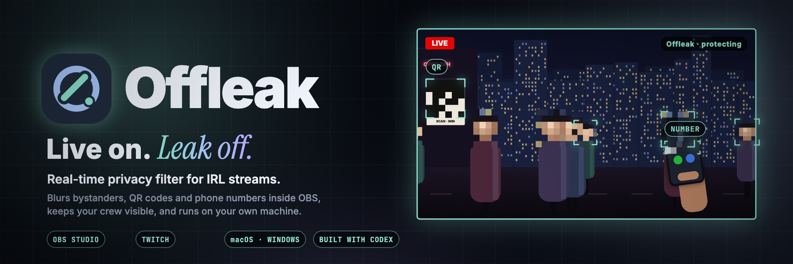
</p>

<div align="center">
  <h1>OFFLEAK</h1>
  <p><strong>A real-time privacy filter for IRL streams. It lives inside OBS, blurs strangers' faces, QR codes and phone numbers before your viewers see them, and keeps your crew visible.</strong></p>
  <p><em>A leak only needs one frame. Offleak checks every one, on your own machine, before it goes out.</em></p>
  <p>
    <a href="submission/submission-description.md"></a>
    <a href="https://twitchcon-codex.devpost.com/"></a>
    <a href="https://dwzbpgm35mwo5.cloudfront.net"></a>
  </p>
  <p>
    <a href="LICENSE"></a>
    
    
    
    
    
    
  </p>
  <p>
    
    
    
    
    
  </p>
  <p>
    <a href="submission/submission-description.md">Submission</a> ·
    <a href="submission/assets/film-hero.gif">One frame</a> ·
    <a href="submission/assets/offleak-architecture.gif">Architecture</a> ·
    <a href="app/README.md">App internals</a> ·
    <a href="playground/README.md">Playground</a>
  </p>
  <p><sub>Camera → Offleak filter → detect faces · QR codes · phone numbers → keep your crew → lookahead buffer → stream</sub></p>
</div>

> [!IMPORTANT]
> Offleak runs entirely on your computer: camera frames and face references never leave it. It is a strong safety net, not a guarantee. Detection can miss a face, a QR code or a very small number, so review your output before relying on it live. Audio is never redacted.

<details>
<summary><kbd>Contents</kbd></summary>

- [At a glance](#-at-a-glance)
- [The problem](#the-problem)
- [One frame, protected](#one-frame-protected)
- [See it work](#see-it-work)
- [What Offleak does](#what-offleak-does)
- [On Twitch](#on-twitch)
- [How it works](#how-it-works)
- [Install](#-install)
- [Set up in OBS](#set-up-in-obs)
- [Run from source](#run-from-source)
- [Verify](#verify)
- [Results](#results)
- [Built with Codex](#built-with-codex)
- [Honest limits](#honest-limits)
- [Repository map](#repository-map)
- [License and attribution](#license-and-attribution)

</details>

## 🛡 At a glance

<table>
  <tr>
    <td width="25%" align="center"><strong>01 / SEE</strong><br><br>Every camera frame goes through the Offleak filter in OBS before anything else.</td>
    <td width="25%" align="center"><strong>02 / DETECT</strong><br><br>Faces, QR codes and phone numbers, in parallel, on your own GPU or CPU.</td>
    <td width="25%" align="center"><strong>03 / DECIDE</strong><br><br>Your crew stays visible. Strangers, codes and numbers get pixelated. Unsure? The whole frame blurs.</td>
    <td width="25%" align="center"><strong>04 / STREAM</strong><br><br>Only protected frames reach OBS output, Twitch and your recording.</td>
  </tr>
</table>

## The problem

IRL streams pull strangers into frame, and screens, tickets and QR codes slip in with them. One frame is enough: IShowSpeed flashed KSI's number to a live audience, RaKai was banned after leaking an NBA star's number, and fans swarmed Kai Cenat and Speed after an address leaked on stream. Sources are listed in the [submission description](submission/submission-description.md#inspiration).

<p align="center">
  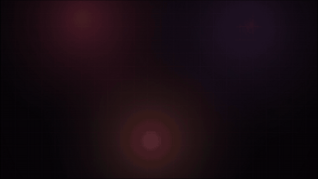
</p>

> Live, there's no undo. Can every frame be checked before it goes out, without the streamer changing how they stream?

## One frame, protected

<p align="center">
  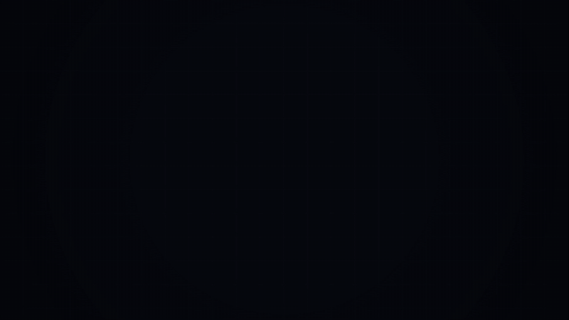
</p>

<p align="center">
  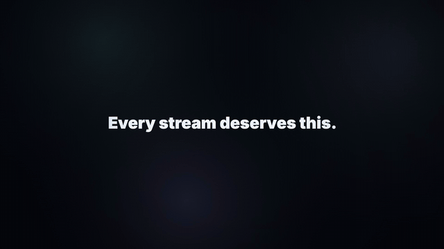
</p>

## See it work

Three tests from the real OBS recording (crops of the OBS preview output):

| Result 01 · Screens | Result 02 · Crowd | Result 03 · Known vs. stranger |
| --- | --- | --- |
| 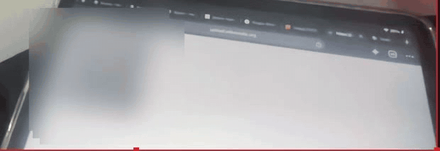 | 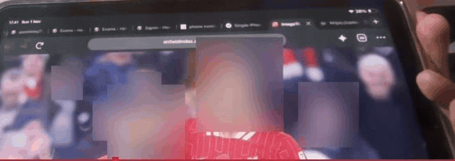 | 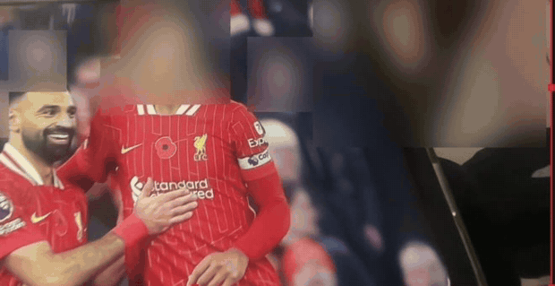 |
| Numbers and QR codes: **masked**. | Every face in the crowd: **blurred**. | Added person **visible**, stranger **blurred**. |

<table>
  <tr>
    <td width="50%">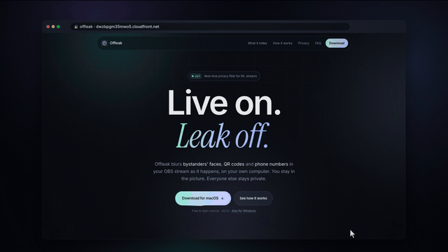<br><sub><strong>Install.</strong> One installer for macOS or Windows sets up everything, including the OBS filter.</sub></td>
    <td width="50%">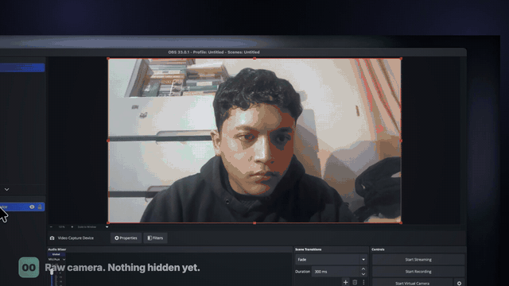<br><sub><strong>Set up.</strong> Copy the dock link, dock it in OBS, add the filter to your camera.</sub></td>
  </tr>
  <tr>
    <td width="50%">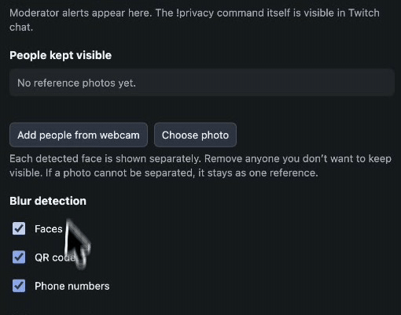<br><sub><strong>Keep your people.</strong> One click on <em>Add people from webcam</em> (real recording).</sub></td>
    <td width="50%">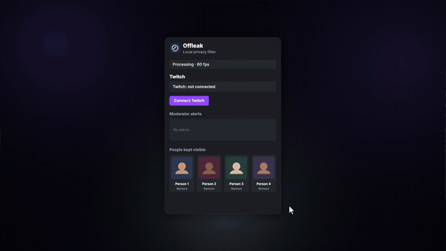<br><sub><strong>On Twitch.</strong> Live status and moderator <code>!privacy</code> alerts in your dock.</sub></td>
  </tr>
</table>

| The website | Copy the dock link | Custom Browser Docks |
| --- | --- | --- |
| 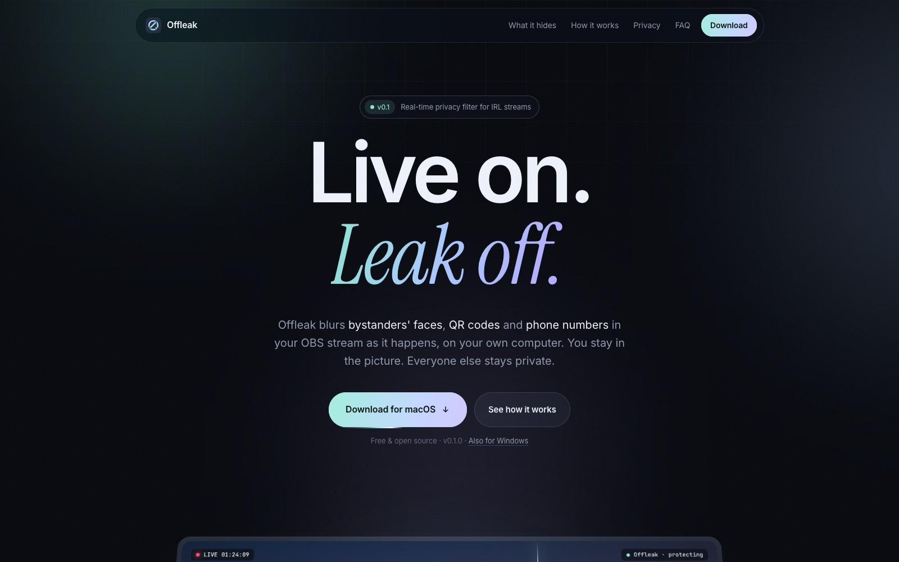 | 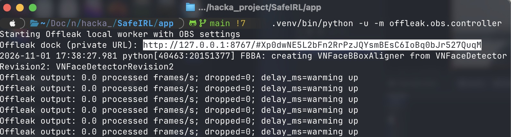 | 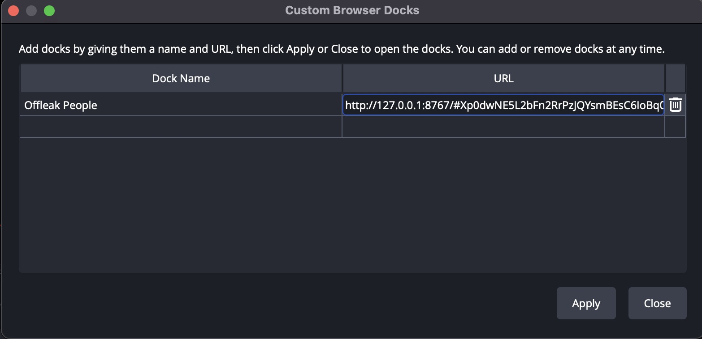 |

| Add the filter | Filter properties | The Offleak dock |
| --- | --- | --- |
| 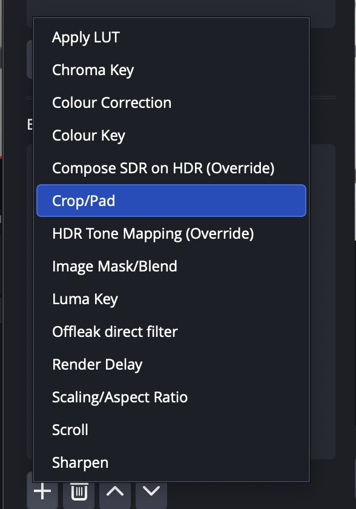 | 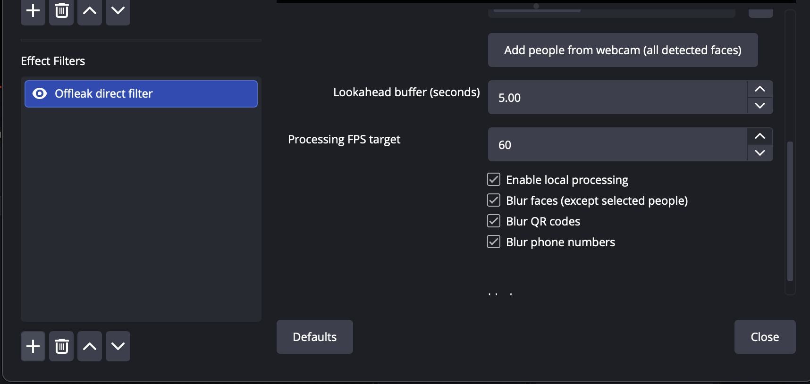 | 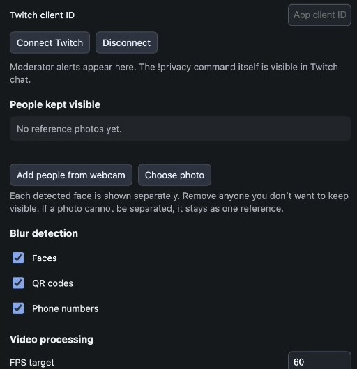 |

## What Offleak does

| | Capability | What the streamer gets | How it is built |
| --- | --- | --- | --- |
| 🙈 | **Strangers blurred** | Every face that isn't on your list is pixelated. | Pose-based head finding + YuNet / Apple Vision faces, tracked between detections with sparse optical flow. |
| 🤝 | **Your crew visible** | Add people from the webcam or a photo; they stay clear. | SFace embeddings in a local face gallery with identity votes; group photos split into separate cards. |
| 🔳 | **QR codes masked** | Tickets, boarding passes and screens with QR codes are covered. | QR detector model + Apple Vision barcodes (macOS) or OpenCV (Windows), with rotation and mirror probes. |
| ☎️ | **Phone numbers masked** | Numbers on phones, screens and paper are covered. | Apple Vision OCR (macOS) or RapidOCR (Windows), screen-crop zoom re-reads, phone-number rules. |
| ⏱ | **Checked before it streams** | Each output frame is checked first; unsure means blur everything. | Lookahead buffer, flow-carried boxes, 1-second fail-closed rule. |
| 🎛 | **Lives in OBS** | A filter on your camera and a dock for people, switches, fps (5–60) and status. | Native C OBS filter + Flask dock on `127.0.0.1:8767` behind a private token. |
| 📺 | **Talks to Twitch** | Live status and moderator `!privacy` alerts in the dock. | Twitch EventSub over WebSocket: `stream.online`, `channel.chat.message`. |

## On Twitch

| Twitch event | What Offleak does |
| --- | --- |
| **Connect Twitch** | OAuth from the dock with only the `user:read:chat` scope. No client secret in the app; the access token stays in controller memory. |
| **`stream.online` / `stream.offline`** | The dock shows **Live on Twitch**. |
| **`channel.chat.message`** | When the broadcaster or a moderator types exactly `!privacy`, a privacy flag appears in the dock. The chat message itself is public; the alert is local. |

To connect, register an app in the [Twitch Developer Console](https://dev.twitch.tv/console/apps) with `http://localhost:8767/twitch/callback` as the OAuth redirect URL, enter its client ID in the dock, and choose **Connect Twitch**. Protection never depends on Twitch being connected.

## How it works

<p align="center">
  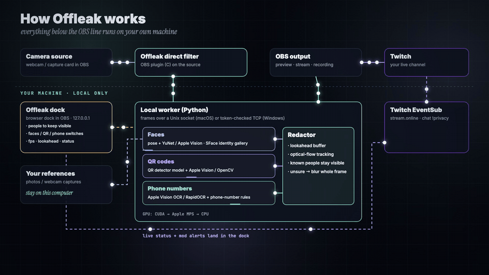
</p>

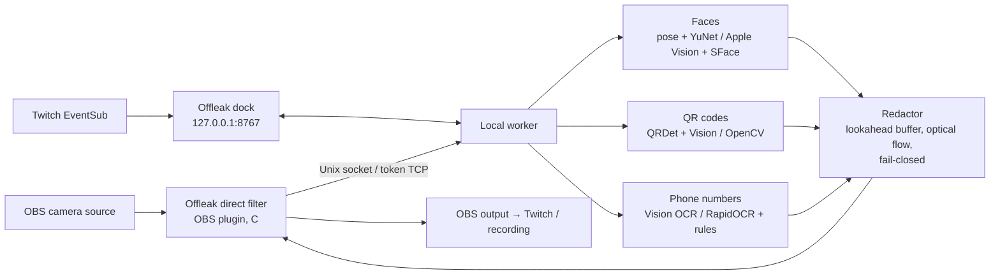

<p align="center">
  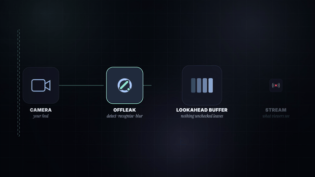
</p>

- **Every output frame is blurred where needed.** Detectors run as often as the machine allows on the newest frame; optical flow carries each box onto every frame in between, so a higher fps never skips protection.
- **Fail closed.** If a detector stalls for more than a second, or a pass fails, the whole frame is blurred.
- **Hardware:** GPU order is CUDA → Apple MPS → CPU; on Windows, text reading uses DirectML on any GPU.
- **Memory:** the lookahead holds `delay × fps` frames (1280×720, about 2.8 MB each); 5 s at 60 fps is about 0.8 GB.

## ⚡ Install

| Platform | Download | Notes |
| --- | --- | --- |
| **macOS** (Apple Silicon, OBS 33) | [Offleak-0.1.0.dmg](https://dwzbpgm35mwo5.cloudfront.net/downloads/Offleak-0.1.0.dmg) | Open the DMG and run **Install Offleak**. First open: right-click › Open. It copies Offleak to `~/Applications/Offleak`, then installs Python packages, models and the OBS plugins (about 10 minutes, needs internet). |
| **Windows** 10/11 64-bit (OBS 33) | [Offleak-Setup-0.1.0.exe](https://dwzbpgm35mwo5.cloudfront.net/downloads/Offleak-Setup-0.1.0.exe) | Close OBS first. Installs a private Python, the GPU libraries for your card, the models and the OBS filter (1–3 GB). SmartScreen: More info › Run anyway. |

Website: [dwzbpgm35mwo5.cloudfront.net](https://dwzbpgm35mwo5.cloudfront.net)

<p align="center">
  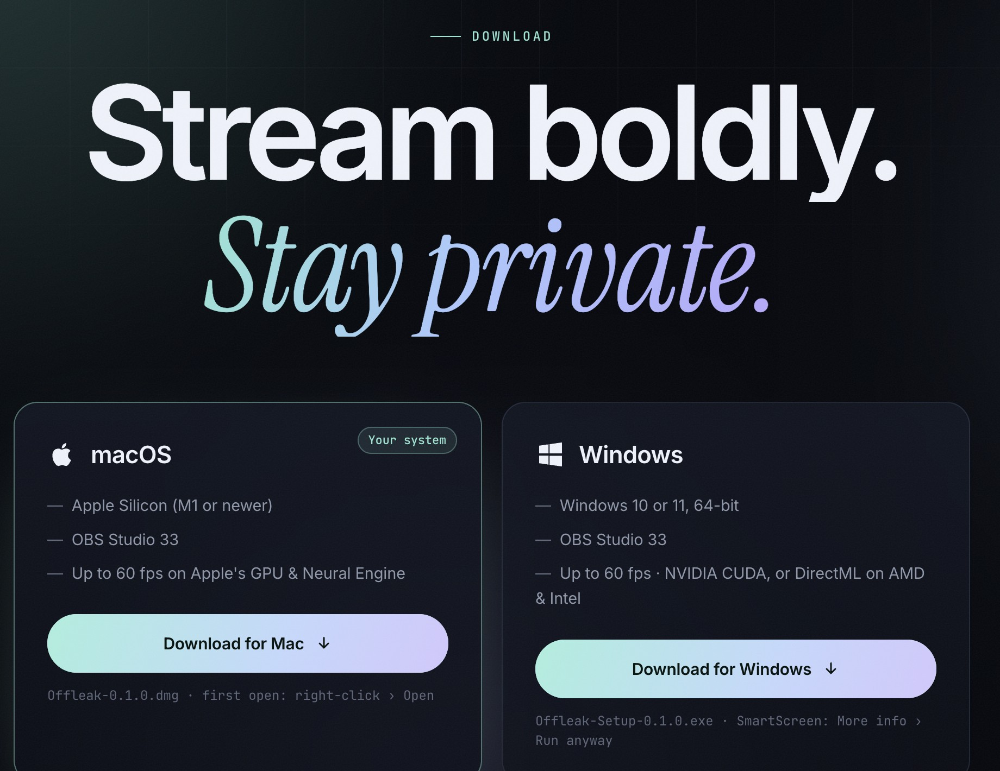
</p>

## Set up in OBS

<p align="center">
  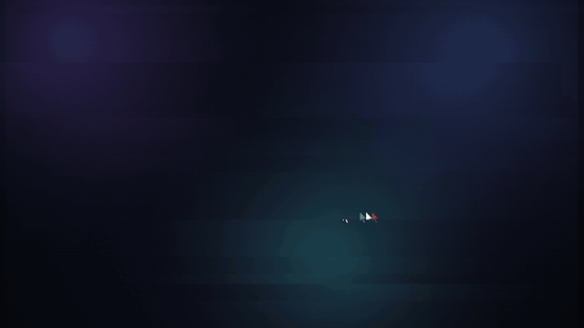
</p>

1. **Add your camera** in OBS as a normal **Video Capture Device**.
2. **Start Offleak** (`Start Offleak` on Windows, `Start Offleak Direct.command` on macOS) and copy the **private dock URL** it prints (`http://127.0.0.1:8767/#<token>`).
3. In OBS choose **Docks → Custom Browser Docks…**, name it **Offleak People**, paste the URL and click **Apply**.
4. Right-click the camera › **Filters** › **+** › **Offleak direct filter**.
5. In the dock, click **Add people from webcam** (or **Choose photo**) for everyone who should stay visible. Everyone else is blurred.

Keep the dock URL private: its token grants access to the dock's reference images and controls. The preview stays black while models load and the lookahead buffer fills.

## Run from source

The clean app lives in [`app/`](app/); see [`app/README.md`](app/README.md) for internals. Commands run from `app/`.

| What | How |
| --- | --- |
| Install (venv, models, OBS source, scene collection) | double-click `Install Offleak.command` |
| Direct filter + dock | double-click `Start Offleak Direct.command`, then open `http://127.0.0.1:8767/#<token>` |
| Virtual Camera path (launcher) | double-click `Start Offleak.command` |
| Debug UI | `.venv/bin/python -m offleak.ui.server` → http://127.0.0.1:8765 |
| Redact a file (audio copied) | `.venv/bin/python -m offleak.cli.redact in.mp4 out.mp4 --exclude face.png` |
| Live from the command line | `.venv/bin/python -m offleak.cli.stream in.mp4 out.mp4 --realtime --preview` |
| Build the native OBS pieces | `native/build_direct_filter.sh`, `native/build_source.sh`, `native/build_windows_plugin.sh` (need `OBS_SDK`, `SIMDE_INCLUDE`) |
| Build the installers | `installers/build_macos.sh` → `dist/Offleak-0.1.0.dmg`, `installers/build_windows.sh` → `dist/Offleak-Setup-0.1.0.exe` |

## Verify

```sh
cd app
.venv/bin/python -m pytest tests            # 30 tests: core, detectors, dock, OBS transport
.venv/bin/python tools/benchmark/bench.py make
.venv/bin/python tools/benchmark/bench.py eval --report r.json
```

The pytest suite covers logic, transport and the dock; it does not prove live privacy coverage. The benchmark uses synthetic ground truth on real footage.

## Results

<p align="center">
  
  
  
</p>

At live detector rates, on clips never used for tuning (random mirroring, rotation, low resolution, motion blur, JPEG and brightness):

| Set | QR | Phone | Streamer visible | Bystanders blurred | Longest leak QR / phone |
| --- | --- | --- | --- | --- | --- |
| Upright | 99.5% | 99.7% | 91.0% | 98.3% | 133 ms / 100 ms |
| Handheld rotation | 95.6% | 78.5% | 88.9% | 93.9% | 1.3 s / 4.0 s |

- With every detector on every frame (offline), QR and phone were both 100% with zero exposure gap.
- Live run of a 176 s clip on an M1 Pro: all 5,285 frames at 29.98 fps, 0 dropped, delay flat at 1.51 s.
- Direct OBS filter, 60 fps target, M1 Pro webcam test: about 44–51 processed frames/s.

Full write-up: [`playground/results/reports/COMBINED_PIPELINE.md`](playground/results/reports/COMBINED_PIPELINE.md).

## Built with Codex

<p align="center">
  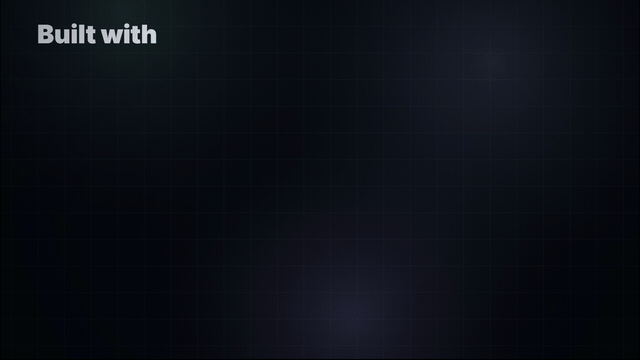
</p>

Every step ran through **Codex** as a **multi-agent** process with **human review** at each gate: research, model experiments in the [`playground/`](playground/) (YuNet, SFace, SCRFD, Apple Vision, YOLO pose and head models, RapidOCR, QR detectors, BoT-SORT/ByteTrack), tune → optimize → evaluate loops against the benchmark, then the clean [`app/`](app/), the C OBS filter, the dock, Twitch EventSub, and the macOS and Windows installers.

## Honest limits

- **Not a guarantee.** Faces can be missed or matched to the wrong person, and numbers under about 12 px tall are missed. Review the output first.
- **Identity switches** near the streamer can unblur a bystander for under a second.
- **Audio is never redacted**, and the lookahead delays video; set a matching audio delay in OBS.
- **Twitch** status and alerts may be delayed during a disconnect. Protection must be running before you go live and never depends on Twitch.
- **Licences:** Ultralytics and QRDet weights are AGPL-3.0.

## Repository map

| Path | Purpose |
| --- | --- |
| [`app/`](app/) | The clean Offleak app: `offleak/` package (detection, redaction, pipeline, OBS worker, dock, Twitch), native OBS plugins, installers, website, tests, benchmark. |
| [`playground/`](playground/) | Experiments, benchmarks and reports that led to the app. |
| [`submission/submission-description.md`](submission/submission-description.md) | Devpost-ready project story. |
| [`submission/assets/`](submission/assets/) | Banner, animated architecture and film GIFs. |
| [`submission/screenshots/`](submission/screenshots/) | App, OBS and website screenshots. |
| [`video/`](video/) | The demo film's source: canvas engine, voice-over, score, renderer, and these README assets ([`video/scripts/readme_assets.py`](video/scripts/readme_assets.py)). |

## License and attribution

Offleak is licensed under [AGPL-3.0](LICENSE).

- The banner, animated diagrams and `film-*.gif` excerpts come from Offleak's own demo film, drawn on canvas by [`video/comp/`](video/comp/); its score and sound design are synthesized in [`video/scripts/audio.py`](video/scripts/audio.py), and the voice-over uses Qwen3-TTS. The street scene and Twitch page are illustrations.
- `demo-*.gif` and the dock screenshot are crops of the real OBS recording.
- News headlines are quoted with links to their sources in the [submission description](submission/submission-description.md#inspiration).
- Models and dependencies keep their own licences; Ultralytics and QRDet are AGPL-3.0.
- OBS Studio, Twitch, Apple, macOS and Windows are trademarks of their respective owners; no affiliation or endorsement is implied.
