

  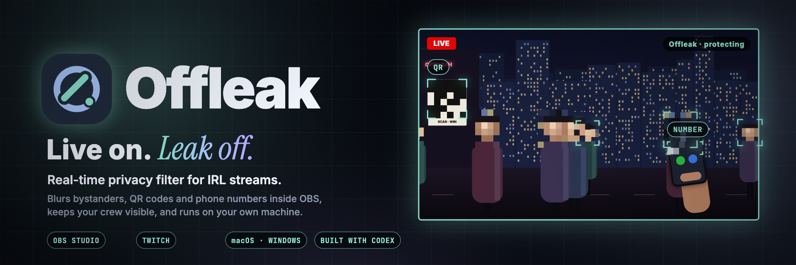

# Offleak

## Live on. Leak off.

**Offleak** is a real-time privacy filter for IRL streamers. It runs inside **OBS** on your own computer and blurs **strangers' faces, QR codes and phone numbers** before a single frame reaches your viewers, while **your crew stays visible**. It connects to your **Twitch** channel, knows when you go live, and lets your moderators raise a privacy alert from chat with `!privacy`.

  
  
  
  

## Inspiration

An IRL stream only needs **one frame** to leak something it can never take back.

  

It keeps happening on the biggest channels:

- IShowSpeed flashed KSI's phone number to a live audience ([Dexerto](https://www.dexerto.com/entertainment/ishowspeed-blatantly-leaks-ksis-phone-number-on-instagram-1861669/), [Sportskeeda](https://www.sportskeeda.com/esports/ishowspeed-leaks-ksi-s-number-mistake)), and Adin Ross later leaked Speed's ([Dexerto](https://www.dexerto.com/youtube/adin-ross-apologizes-to-ishowspeed-after-leaking-his-number-2611960/)).
- RaKai was banned again after leaking an NBA star's number ([EarlyGame](https://earlygame.com/news/influencers/rakai-banned-again-after-leaking-nba-stars-phone-number-faces-permaban-risk)); a 17-year-old showed an FC Bayern star's private number live ([Mein-MMO](https://mein-mmo.de/en/youtube-17-year-old-shows-live-the-private-number-of-football-star-from-fc-bayern-3-seconds-later-the-phone-goes-crazy,896485)).
- Fans swarmed Kai Cenat and IShowSpeed after an address leaked on stream ([Dexerto](https://www.dexerto.com/entertainment/fans-swarm-kai-cenat-ishowspeed-after-address-leaks-on-stream-2194832/)).
- Bystanders never agreed to be streamed ([Dexerto](https://www.dexerto.com/entertainment/man-threatens-to-break-irl-streamers-camera-for-filming-in-public-1344237/)), and a boarding pass or ticket QR is enough to take over a booking ([One Mile at a Time](https://onemileatatime.com/news/traveler-learns-hard-way-dont-share-airline-ticket-details-online)).

  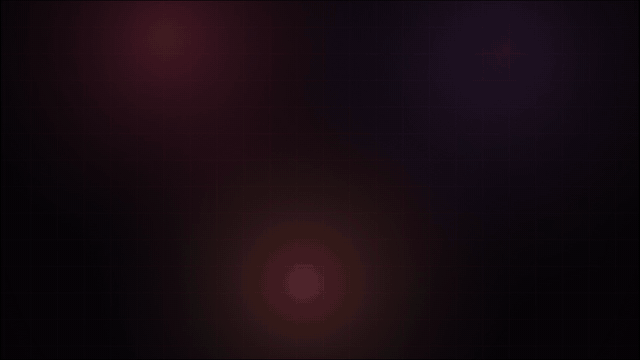

Live, there's no undo. Streamers can't watch every screen, ticket and stranger that drifts into frame, so we built the tool we wished they had: one that checks every frame *before* it goes out.

## What it does

  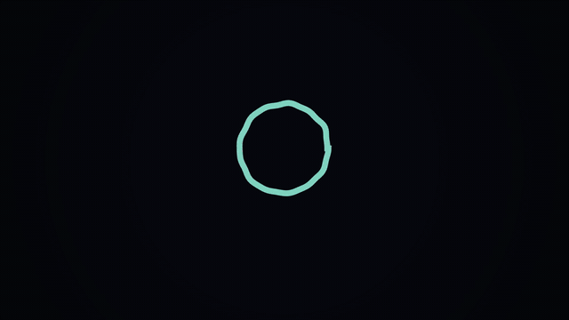

| Offleak capability | What it does | Why it matters |
| --- | --- | --- |
| **1 · Blurs strangers' faces** | Detects every face in frame and pixelates anyone who isn't on your list. | Bystanders keep their privacy; you keep streaming. |
| **2 · Keeps your crew visible** | Add people with one click from your webcam or a photo; Offleak recognises them and leaves them clear. | It's a filter for strangers, not for your show. |
| **3 · Masks QR codes and phone numbers** | Reads screens, tickets and paper in frame and covers any QR code or phone number it finds. | The leaks that end careers are usually small text. |
| **4 · Checks before it streams** | A short lookahead buffer means each frame is checked before it leaves OBS; if Offleak is ever unsure, it blurs the whole frame. | It fails closed, not open. |
| **5 · Lives in OBS** | An OBS filter on your camera plus a dock panel for people, switches, fps and status. | No new streaming software to learn. |
| **6 · Talks to Twitch** | Shows when you go live, and turns a moderator's `!privacy` in chat into an alert in your dock. | Your mods become a second pair of eyes. |

## Product walkthrough

<table>
  <tr>
    <td width="50%">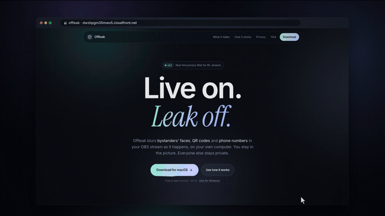 <strong>1 · Install.</strong> Download for macOS or Windows; the installer sets up Python, the models and the OBS filter for you.</td>
    <td width="50%">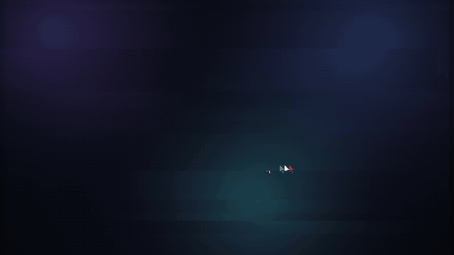 <strong>2 · Add your camera.</strong> A normal OBS Video Capture Device, nothing special.</td>
  </tr>
  <tr>
    <td width="50%">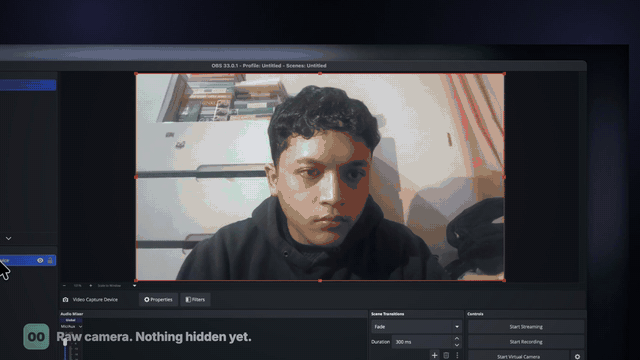 <strong>3 · Dock and filter.</strong> Start Offleak, copy its private dock link, paste it into a browser dock, then add the Offleak filter to the camera.</td>
    <td width="50%">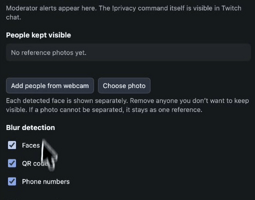 <strong>4 · Keep your people.</strong> Real recording: one click on <em>Add people from webcam</em>.</td>
  </tr>
</table>

### Three tests from the real OBS recording

| Result 01 · Screens | Result 02 · Crowd | Result 03 · Known vs. stranger |
| --- | --- | --- |
| 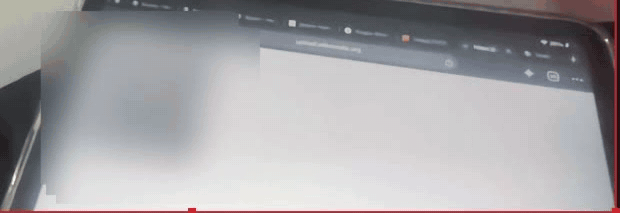 | 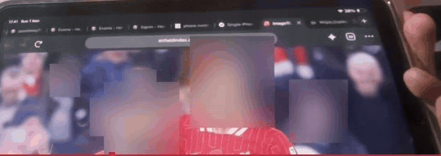 | 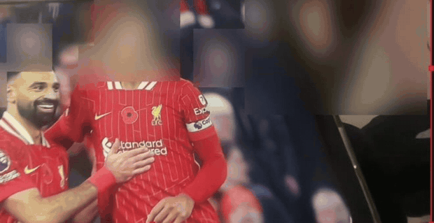 |
| Numbers and QR codes on a screen: **masked**. | Every face in the crowd: **blurred**. | Added person: **visible**. Stranger beside him: **blurred**. |

Crops of the real OBS preview output. The streamer appears in the full recording but is cropped out here.

| The website | Copy the dock link | Custom Browser Docks |
| --- | --- | --- |
| 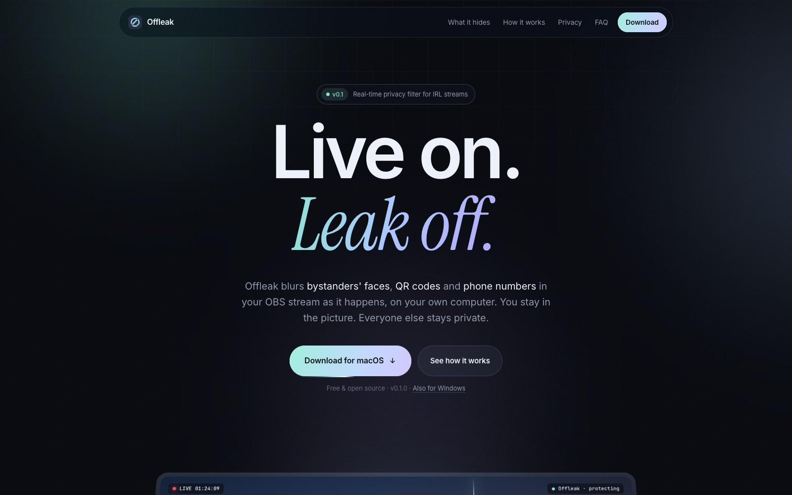 | 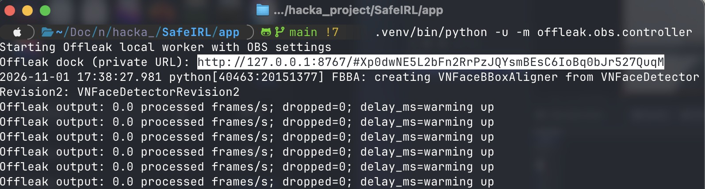 | 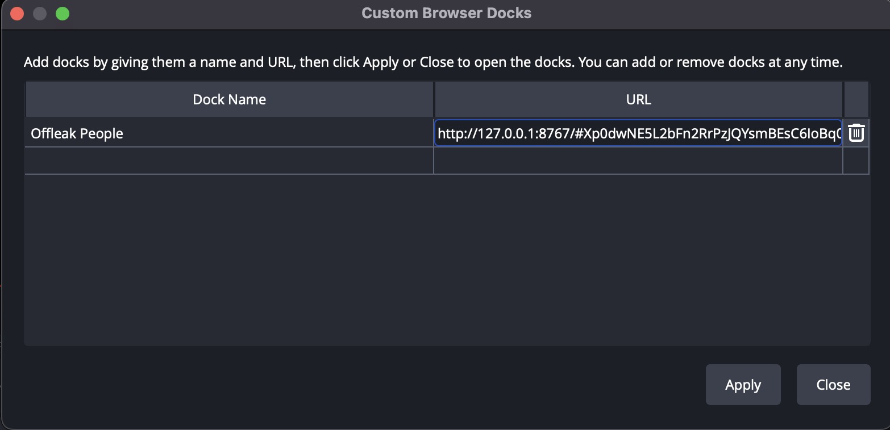 |

| Add the filter | Filter properties | The Offleak dock |
| --- | --- | --- |
| 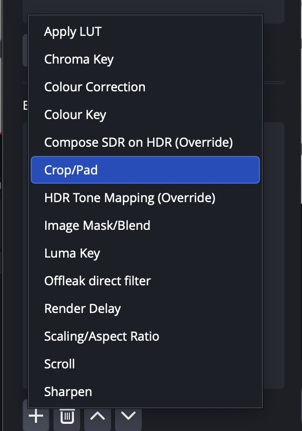 | 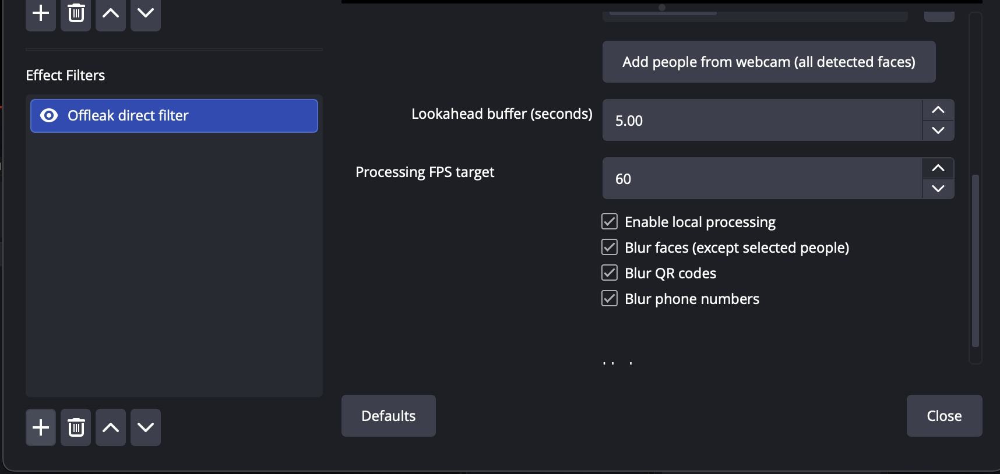 | 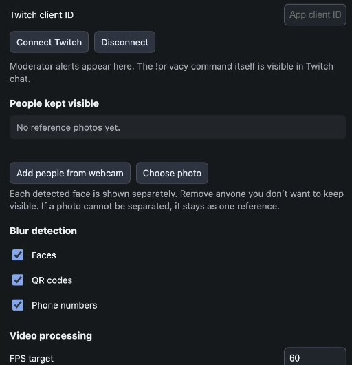 |

## On Twitch

  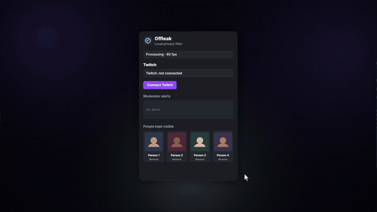

| Twitch event | What Offleak does |
| --- | --- |
| **Connect Twitch** | OAuth in the dock with only the `user:read:chat` scope. No client secret in the app; the token stays in memory. |
| **`stream.online` / `stream.offline`** (EventSub) | The dock flips to **Live on Twitch**, so you can see protection is on before the stream starts. |
| **`channel.chat.message`** (EventSub) | When the broadcaster or a moderator types exactly `!privacy`, a privacy flag lands in your dock. |
| **What Twitch never gets** | Camera frames and face references never leave your computer. |

## How it works

  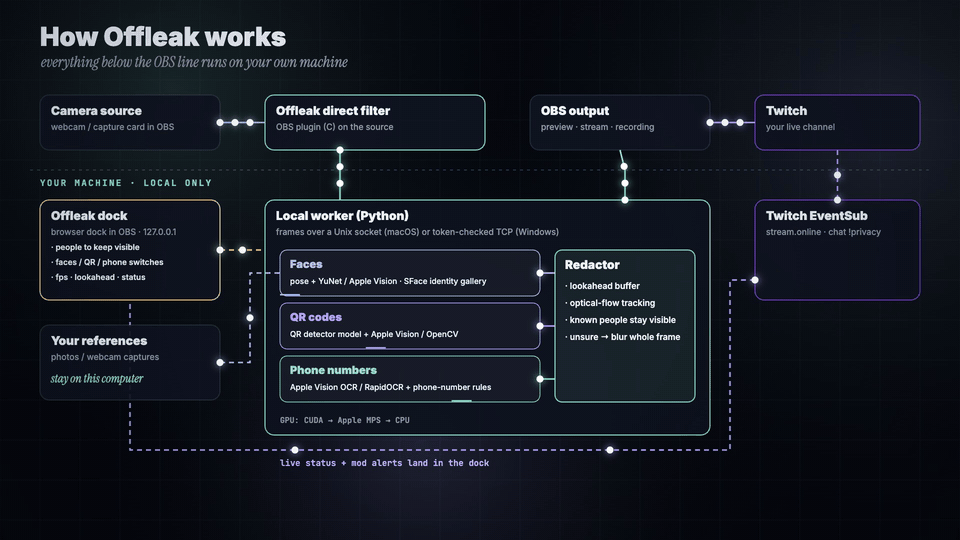

1. The **Offleak filter** (an OBS plugin written in C) hands each camera frame to a **local worker** over a Unix socket on macOS, or a token-checked loopback TCP connection on Windows.
2. Three detector lanes run in parallel on the newest frame: **faces** (pose + YuNet or Apple Vision, with SFace matching against your people), **QR codes** (a QR detector model plus Apple Vision or OpenCV) and **phone numbers** (Apple Vision OCR or RapidOCR, then phone-number rules).
3. The **redactor** holds a lookahead buffer, carries every blur box onto the frames in between with sparse optical flow, and keeps known people clear.
4. If a detector stalls or is unsure, the whole frame is blurred. The filter shows the redacted frame in OBS, so the stream and any recording only ever see protected video.

  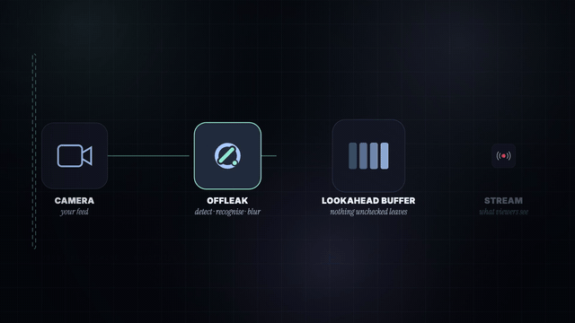

| Offleak will | Offleak won't |
| --- | --- |
| Check every output frame, and blur the whole frame when a detector stalls or is unsure. | Send your video, your face references or your viewers' data anywhere. |
| Keep the people you added visible, even inside a group photo. | Unblur someone just because they look similar: matching needs a confident face match. |
| Run on Apple Silicon, NVIDIA CUDA, DirectML for text on AMD/Intel, or the CPU. | Delay or redact your audio; audio is left untouched. |

## How we built it, with Codex

  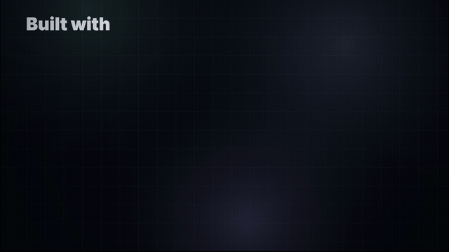

Every step ran through **Codex**, as a **multi-agent** process with **human review** at each gate:

- **Research agents** surveyed detectors, OBS integration paths and real leak cases.
- **Model experiments** compared YuNet, SFace, SCRFD, Apple Vision, YOLO pose and head models, RapidOCR, QR detectors and BoT-SORT/ByteTrack in a playground with a synthetic ground-truth benchmark.
- **Tune → optimize → evaluate, again and again:** detector rates, holds, rotation handling, parallel detector passes (heads ~100 → ~68 ms, objects ~170 → ~127 ms on an M1 Pro) and fail-closed rules.
- **Human review** approved each change against the benchmark and the live OBS test before it moved on.
- **Build and port:** the clean app (strategy + decorator detectors behind one facade), the C OBS filter, the dock, Twitch EventSub, then macOS and Windows installers and the website.

| Technology | Role in Offleak |
| --- | --- |
| **OBS Studio 33 · C (libobs)** | The Offleak direct filter on the camera source; the Virtual Camera source as a fallback. |
| **Python 3.11** | Local worker, detectors, redactor, dock and Twitch monitor. |
| **PyTorch · Ultralytics** | Pose-based head finding; GPU order is CUDA → Apple MPS → CPU. |
| **OpenCV** | YuNet faces, SFace identity, QR detection, sparse optical-flow tracking. |
| **Apple Vision (PyObjC)** | On-device OCR, barcodes and faces on macOS. |
| **RapidOCR · ONNX Runtime DirectML** | Text reading on Windows, on any GPU. |
| **QRDet · phonenumbers** | QR-specific detection and phone-number validation. |
| **Flask** | The token-protected OBS dock on `127.0.0.1:8767`. |
| **Twitch EventSub (WebSocket)** | `stream.online` and `!privacy` chat alerts. |
| **DMG + AppleScript · NSIS** | One-click installers for macOS and Windows. |
| **Amazon S3 · CloudFront** | The website and downloads. |
| **Codex** | Multi-agent research, experiments, tuning, building and porting, with human review. |

## Results

Benchmark: random 4-second clips with pasted QR codes and phone numbers at known positions, plus random mirroring, rotation, low resolution, motion blur, JPEG and brightness changes, scored on a set never used for tuning, at live detector rates.

  
  
  
  

| Set | QR | Phone | Streamer visible | Bystanders blurred | Longest leak QR / phone |
| --- | --- | --- | --- | --- | --- |
| Upright | **99.5%** | **99.7%** | 91.0% | **98.3%** | 133 ms / 100 ms |
| Handheld rotation | 95.6% | 78.5% | 88.9% | 93.9% | 1.3 s / 4.0 s |

With every detector on every frame (offline), QR and phone were both 100% with zero exposure gap. A live run of a 176-second clip on an M1 Pro produced all 5,285 frames at 29.98 fps with 0 dropped and a flat 1.51 s delay. In the direct OBS filter at a 60 fps target, the worker processed about 44–51 frames/s on an M1 Pro.

## Challenges we ran into

- **Fast enough, safe enough.** Detectors can't run on every 60 fps frame, so blur boxes ride on optical flow between detections, and a stalled detector blurs everything instead of letting frames through.
- **Your crew vs. strangers.** Identity has to be confident before anyone is unblurred; group photos are split into separate face cards you can remove one by one.
- **Small, rotated text.** Phone numbers on a tilted phone or a held-up screen needed rotation probes, mirror votes and zoomed re-reads of screen crops.
- **Inside OBS, on two platforms.** A native C filter, a local worker and a token-protected dock, packaged for Apple Silicon and for Windows with CUDA, DirectML or CPU.

## Accomplishments we're proud of

  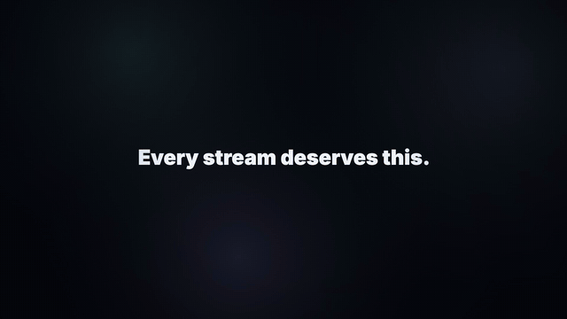

- A privacy filter that runs **inside OBS, on the streamer's own machine**, and fails closed.
- **Your people stay visible**: one click from the webcam, even from group photos.
- 99.5% of QR codes, 99.7% of phone numbers and 98.3% of bystanders protected on an unseen benchmark set at live rates.
- One-click installers for **macOS and Windows**, a website, and Twitch live status with moderator `!privacy` alerts.

## What we learned

The hardest part of a privacy tool isn't detection, it's deciding what happens when detection isn't sure. Offleak's answer is to look ahead, carry every box, and blur the whole frame rather than guess. And streamers don't want another app: it has to live where they already work, in OBS, and get out of the way.

## What's next

- Automatic OBS dock setup, so no link needs to be copied.
- Tracking tuned for fast handheld turns, where phone-number recall is lowest today.
- More languages and number formats, plus license plates and addresses on signs.
- A Linux build, and testing with more IRL streamers and moderators.

## Honest limits

- **Not a guarantee.** Detection can miss a face, a QR code or a very small number; review the output before relying on it live.
- **Twitch** status and alerts are built on EventSub; Offleak's protection never depends on Twitch being connected. The Twitch page in the film is a mock-up of a live channel.
- **Model licences:** Ultralytics and QRDet weights are AGPL-3.0, and Offleak is released under AGPL-3.0 too.

## Try it

- **Download:** [dwzbpgm35mwo5.cloudfront.net](https://dwzbpgm35mwo5.cloudfront.net) · [macOS (.dmg)](https://dwzbpgm35mwo5.cloudfront.net/downloads/Offleak-0.1.0.dmg) · [Windows (.exe)](https://dwzbpgm35mwo5.cloudfront.net/downloads/Offleak-Setup-0.1.0.exe)
- **Source:** [github.com/azharizz/offleak](https://github.com/azharizz/offleak)
- **Run from source:** see the [README](https://github.com/azharizz/offleak#run-from-source)
